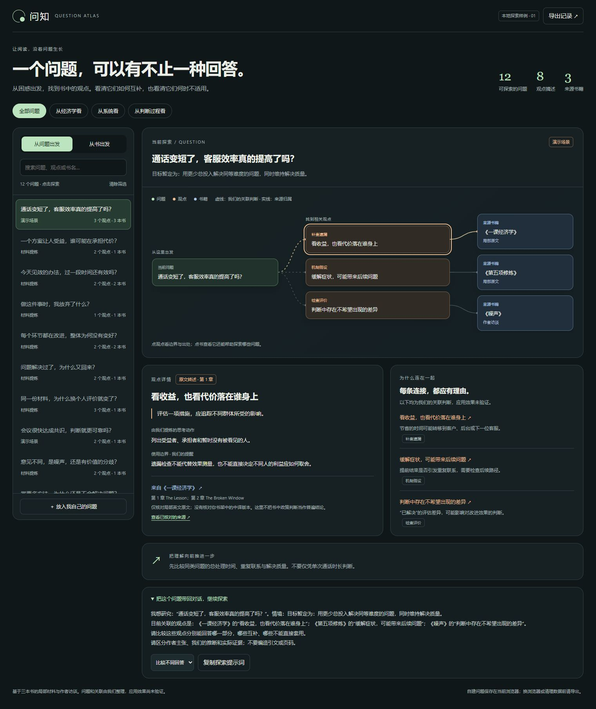

# Question-Action

> 一组围绕“找到问题 → 理解问题 → 学习知识 → 判断 → 行动 → 反馈”构建的 AI Skills。
>
> 这个仓库最初从 Question-Action Reading 开始，现在逐渐发展成一套**问题驱动的学习与推理工具集**。

当前包含三个彼此独立、但可以组合使用的 Skill。

## 实验中的问题与书网络

正在试验把阅读积累为 **问题 → 观点或方法 → 书中出处** 的网络：一个问题可以关联多本书，一本书也可以贡献多个不同的回答。每条关联保留理由、适用边界，以及作者主张与我们推断的区别。

- [设计说明与待验证假设](./docs/hypotheses/question-book-network.md)
- [Question-Action Reading v0.4.0-draft](./drafts/question-action-reading/SKILL.md)：试用草案，不替换正式 v0.3.0。
- [首次提炼样例](./drafts/question-action-reading/examples/economics-thinking-pilot.md)：使用《一课经济学》《第五项修炼》的局部原文及《噪声》作者访谈。
- [问知交互 HTML](./prototypes/question-book-atlas.html)：12 个问题、8 个观点、3 本书，支持搜索、问题与书双向浏览、手动添加问题及导出记录。
- [下一轮样本与验证计划](./docs/experiments/question-book-network-next.md)

**打开 HTML：**下载 `prototypes/question-book-atlas.html`，用浏览器打开即可。页面的样式、数据和交互都包含在单个文件中；查看外部原文链接需要联网。GitHub 的文件页显示源码，这里尚未配置在线网站。

自建问题保存在当前浏览器的本地存储中，不会自动写回 GitHub；不同打开地址、浏览器或清理数据可能影响记录可用性，请导出备份。目前导出供保留和后续处理，尚不提供导入功能。



当前成果是局部材料提炼与交互原型，应用关联尚未经过真实问题验证；不代表三本书的完整蒸馏，也不代表新草案已被证明优于旧版。

## 一张图看懂三个 Skill

```text
模糊困惑 / 现象
       ↓
Question Framing
我真正应该问什么？
       ↓
 Working Question
       ↓
Question → Explanation → Action
这个问题该怎么理解、验证、下钻、行动并用反馈更新？
       ↓
如果需要书里的知识或模型
       ↓
Question-Action Reading
怎样围绕问题去学习一本或多本书？
```

这不是固定流水线。

任何一个 Skill 都可以单独使用；后续证据如果暴露原问题框架有误，也可以返回 Question Framing。

---

## Skills

### 1. Question Framing · v0.1.0

**用途：在认真回答之前，先确认“现在问的是不是值得回答的问题”。**

核心通路：

> 现象还原 → 目标还原 → 问题诊断 → 候选问题 → Working Question

它不寻找“宇宙里唯一真正的问题”，而是形成一个：

> **当前最值得研究、可以被证据继续修正的工作问题。**

- [README：给人看的问题重构方法](./skills/question-framing/README.md)
- [SKILL.md：给 AI 执行的规则](./skills/question-framing/SKILL.md)

适合：

- 我只有模糊困惑，不知道真正应该问什么；
- 怀疑自己一开始就问错了问题；
- 我可能把答案、症状或解决方案塞进了问题；
- 一个问题混了多个目标或多个层级；
- 想先确定一个值得研究的 Working Question。

---

### 2. Question → Explanation → Action · v0.2.0

**用途：分析一个已经暂时值得研究的问题，找到当前最有解释力的答案，并决定是否继续下钻、进入系统思考、转向行动，以及如何用现实反馈更新模型。**

核心路由：

> 1. 我到底在问什么？  
> 2. 我是不是偷偷默认了什么？  
> 3. 有哪些可能解释？  
> 4. 如果这些解释是真的，我应该看到什么？  
> 5. 现实证据更支持谁？又反驳谁？  
> 6. 这个原因还值得继续问“为什么”吗？  
> 7. 它是不是其实是一个循环问题？  
> 8. 如果要改变结果，哪里最值得动？
> 9. 行动后，现实有没有按预期变化？

- [README：给人看的 9 条通路与完整架构](./skills/question-explanation-action/README.md)
- [SKILL.md：给 AI 执行的路由规则](./skills/question-explanation-action/SKILL.md)

适合：

- 为什么某件事会发生？
- 当前解释到底是不是关键？
- 证据不完整时应该如何保留不确定性？
- 什么时候应该继续追因，什么时候应该停止？
- 一个问题是否已经变成反馈循环和系统问题？
- 如果要改变结果，真正值得发力的位置在哪里？

---

### 3. Question-Action Reading · v0.3.0

**用途：带着真实问题读一本或多本书，并把书中的 claim、证据、模型与边界转成可检验输入。**

它不以“总结全书”为目标，而是让书真正改变判断和行动。

核心闭环：

> Question → Basic Question → Breakdown → Models → Boundary → Action → Feedback

- [README：给人看的方法说明](./skills/question-action-reading/README.md)
- [SKILL.md：给 AI 执行的规则](./skills/question-action-reading/SKILL.md)

适合：

- 我想用一本书解决一个真实问题；
- 我想判断自己是否真正学会，而不是只记住概念；
- 我想比较多本书对同一个基本问题的不同回答；
- 我希望把阅读结果转成行动，并用反馈修正理解。

---

## 三个 Skill 的边界

| | Question Framing | Question → Explanation → Action | Question-Action Reading |
|---|---|---|---|
| 核心问题 | 我应该问什么？ | 这个问题该怎么想下去并持续更新？ | 一本书怎么帮助这个问题？ |
| 典型输入 | 模糊困惑 / 初始问题 / 症状 | Working Question | 问题 + 一本或多本书 |
| 主要任务 | 还原现象、目标、重构问题 | 竞争解释、证据、下钻、系统、杠杆、反馈更新 | 调用书中模型、区分作者与推断、判断边界、行动 |
| 主要输出 | Working Question | 当前解释、剩余、系统结构、杠杆点 | Learning State、Action、Skill Feedback |
| 停止条件 | 问题已足够支持分析 | 理解已足够或证据不足以继续 | 对当前问题已经学到够用 |
| 是否能单独使用 | 是 | 是 | 是 |

它们有意保留少量重叠，因为现实推理不是一条单向流水线。

例如：

> Question → Explanation → Action 在分析过程中发现原问题框架错了，就应该返回 Question Framing。

---

## 共享的上层原则

三个 Skill 虽然用途不同，但共享几条底层原则：

- **问题优先于内容。** 先确定要解决什么，再决定学什么、查什么。
- **Question 也是假设。** 最初的问题可以被后续证据修正。
- **区分事实、解释和假设。** 不把“听起来合理”直接当成事实。
- **只达到最小充分深度。** 不为了显得深刻而无限追问。
- **边界比口号重要。** 一个方法什么时候不成立，同样重要。
- **理解最终要回到行动。** 如果继续解释已经不再改变判断或行动，就应该停。
- **行动也是验证。** 真实反馈会反过来修正问题和解释。
- **直觉先降级为假设。** 没有依据的“应该如此”不能直接获得事实地位。
- **区分两种差距。** 假设与现实冲突时更新假设；目标与现实有距离时用差距校正行动。
- **系统思考按需启用。** 只有在反复、反馈、延迟、积累、多主体互动或增长受限真正重要时才进入系统层。
- **目标、限制、杠杆点不是一个东西。** 目标回答去哪，限制回答为什么卡住，杠杆点回答改哪里最有效。

---

## Repository Structure

```text
question-action-reading/
├─ README.md
├─ docs/
│  ├─ hypotheses/          # 设计假设与采用条件
│  └─ experiments/         # 下一轮验证计划
├─ drafts/
│  └─ question-action-reading/  # v0.4.0 草案、记录规范与样例
├─ prototypes/
│  ├─ question-book-atlas.html
│  └─ question-book-atlas-preview.jpg
└─ skills/
   ├─ question-framing/
   │  ├─ README.md
   │  └─ SKILL.md
   ├─ question-explanation-action/
   │  ├─ README.md
   │  └─ SKILL.md
   └─ question-action-reading/
      ├─ README.md
      └─ SKILL.md
```

---

## 怎么选？

如果你的起点是：

- **“我感觉哪里不对，但不知道真正该问什么。”** → Question Framing
- **“问题已经比较清楚，我想知道为什么、该不该继续追、哪里值得发力。”** → Question → Explanation → Action
- **“我有一本书，想真正学会并用出来。”** → Question-Action Reading
- **“我先有模糊困惑，后来形成问题，再发现一本书能帮我。”** → 三个 Skill 可以依次组合，但不是强制流程

---

## Hypotheses

项目中的重要未验证结构，不直接升级为正式架构，而是先记录证据和验证条件。

- [Shared Question Operators：多个 Skill 是否共享一个底层问题操作层？](./docs/hypotheses/question-operators.md) — **Unverified**
- [问题与书的网络：跨书积累与检索是否能改善判断？](./docs/hypotheses/question-book-network.md) — **Unverified / 有局部提炼样例与 HTML 原型**

---

## 当前状态

- Question Framing：v0.1.0，第一版问题入口 Skill。
- Question → Explanation → Action：v0.2.0，加入系统检查、限制/杠杆区分与反馈更新。
- Question-Action Reading：v0.3.0，经《第五项修炼》实测后，明确 Reading Adapter 定位与作者/推断分离。
- 实验区：v0.4.0-draft、首次跨书提炼样例和问知 HTML；与上述正式版本分开维护。

接下来会优先通过真实问题测试三个 Skill 的**边界和交接点**，而不是继续为了“完整”增加方法。

## License

暂未确定。后续会根据公开传播、再利用和商业使用边界决定授权方式。
