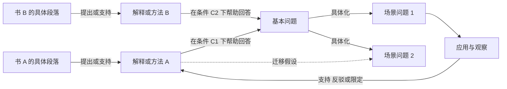

# 从问题驱动阅读到问题与书的网络

状态：设计假设与本地试用草案，尚未经真实读书案例验证。  
日期：2026-10-28

目标是让每次阅读留下可复用的关系：这本书试图回答什么问题、提供什么解释或方法、适用条件是什么，以及后来使用时发生了什么。随着阅读积累，同一个问题可以找到多个回答，同一个方法可以连接多个场景。

## 现有版本已经有什么

[Question-Action Reading v0.3.0](../../skills/question-action-reading/SKILL.md) 已有基本问题抽象、多书比较、作者观点与我们推断的分离、行动卡和反馈。因此，缺口主要是跨次阅读的积累与检索，而不是重新发明一套读书步骤。

原版本的教练交互适合“带我学”：用户先答，一次推进一个问题。但“请整理这些材料能回答哪些问题”属于直接提炼任务，不应该每次都被要求先提供一个个人困惑。草案把这两种交互分开。

## 核心结构

图里的“支持”要注明支持的是哪条主张。作者举例、他人研究和用户的一次成功，证据力度不同。

“问题—书”是查询视图；真正值得保存的连接是“问题—解释或方法—出处—适用边界—使用反馈”。这避免把一本书当成一个统一答案，也避免把提到某话题写成解决了某问题。

并非所有书都提供行动方案。问题也可以是解释性、理解性或价值判断型；文学、历史和哲学材料可以帮助理解、提供反例或澄清价值冲突，不必强行转成操作步骤。

## 两个参考的启发与取舍

| 参考 | 可借鉴的机制 | 在这里的改写 | 不直接照搬的部分 |
|---|---|---|---|
| [女娲 SKILL](https://github.com/alchaincyf/nuwa-skill/blob/main/SKILL.md) 与 [提炼方法](https://github.com/alchaincyf/nuwa-skill/blob/main/references/extraction-framework.md) | 从素材提炼思维模型、条件规则、局限和分歧；检查能否用于新问题 | 把一本或多本书提炼成有出处、可调用的解释和方法 | 人物口吻、身份模拟、以独特性筛选方法。普通但有效的方法同样值得保存 |
| [达尔文 SKILL](https://github.com/alchaincyf/darwin-skill/blob/master/SKILL.md) | 真实任务验证、前后配对比较、保留有改善的修改、可回退 | 用相同案例比较旧版与草案，检查检索、边界和行动是否改善 | 用模型给出的总分证明知识为真；为提高格式分不断增加规则 |

这些是机制上的借鉴，不是执行两个参考 skill 的完整流程，也不依赖它们安装。参考项目提及的研究数据不作为本设计有效性的证明。

女娲的“跨域复现”适合帮助发现候选结构，但在两个领域都出现，不足以证明迁移有效。这里还需检查变量、关系、前提和失效条件。

达尔文式评测检查“这个 skill 是否更好用”；应用反馈检查“这个方法在当前情境是否有帮助”。两种验证应分开，模型偏好不能代替现实证据。

## 三种入口与一种更新

| 用户起点 | 产出 | 主要判断 |
|---|---|---|
| 带我读这本书 | 延续原教练流程与学习状态 | 我是否形成自己的理解 |
| 这本书能回答哪些问题 | 有材料依据的问题地图与方法卡 | 作者明确回答什么，我们额外关联什么 |
| 这个问题有哪些跨书、跨领域回答 | 条件化比较与阅读定位 | 各方法解释哪部分，什么信息能帮助选择 |
| 我用过这个方法，结果是…… | 更新原连接的边界与反馈 | 方法、迁移、执行或问题框架，哪处需要修正 |

一个问题可以有多个回答，一本书可以连接多个问题。新阅读应报告“新增、补强、冲突、限定、待核验”中的实际变化；没有新关系时不为了扩大图谱而加卡。

## 什么叫蒸馏

这里的蒸馏是将材料转成可重复使用的认知动作：

> 遇到什么问题 → 先看哪些线索 → 用什么解释或操作 → 为什么可能有用 → 什么情况下失效 → 去哪里核对。

它不是模型训练意义上的知识蒸馏，也不只是把一本书压缩为几句话。压缩可以省文字，但不能省掉会改变判断的前提、分歧和出处。

“跨领域”应优先寻找相同的关系结构。例如，两个场景都存在资源约束和等待队列，才有理由尝试迁移某些排队分析方法；只因都出现“效率”二字，不能认定机制相同。

## 一个具体但虚构的例子

以下材料 A、B、C 均为设计示例，不对应真实书籍或研究。

问题：为什么投入很多时间，重要任务仍然迟迟不能完成？

| 材料 | 候选解释 | 可能方法 | 辨别线索 | 失效边界 |
|---|---|---|---|---|
| A 个人工作材料 | 频繁切换造成恢复成本 | 保护连续工作时间 | 中断与恢复时间占比高 | 主要时间花在等待他人时，作用可能小 |
| B 流程管理材料 | 太多任务同时开始，等待和交接累积 | 减少同时推进的任务 | 在途任务多、等待时间长 | 工作并行关系不同，不能机械套固定上限 |
| C 目标选择材料 | 局部完成数量与真正目标脱节 | 调整任务选择依据 | 很忙但产出与目标关系弱 | 目标明确且任务必要时，需要别的解释 |

三种方法不应被蒸馏成“提高专注力”。它们可能互补，也可能竞争；先观察中断、等待与任务目标之间的关系，才能判断从哪一处入手。

若把 B 用于个人学习，需注明这次迁移由我们提出，并检查任务依赖、切换成本等对应条件。一次顺利完成作业只能支持该次应用，不能证明所有学习问题都是在途任务过多。

## 最小实现与试用边界

草案放在 [drafts/question-action-reading/SKILL.md](../../drafts/question-action-reading/SKILL.md)，不替换正式版本、不安装到全局目录。目录名保持一致是为了将来比较和迁移，不应同时把两个版本安装为同名技能。

用普通 Markdown 卡片、稳定 ID 和有类型的关系即可开始。图从记录生成，不另维护一套独立事实。暂不引入图数据库、自动爬取整套书目或自动生成大量子 skill。

持久库与 skill 分开：skill 保存工作方法，用户的问题库保存积累的内容。每次只读取当前问题及相邻方法，不把整座知识库塞进提示词。

草案的记录结构见 [network-records.md](../../drafts/question-action-reading/references/network-records.md)。没有可读写目录时交付可复制的增量，明确尚未持久保存，不声称跨聊天自动记住。

## 何时考虑升级正式版

按 [acceptance-cases.md](../../drafts/question-action-reading/references/acceptance-cases.md) 先试用，再用用户真实材料做前后比较。关注这些可观察结果：

- 从一本书能找到具体问题和出处，而不只是主题标签。
- 从一个问题能找到条件不同的回答，并解释为何取舍。
- 新材料加入时能复用原节点，保留真正的分歧。
- 第二次聊天读入记录后，能找回相关方法及已有反例。
- 遇到不适合迁移的场景，能够拒绝类比或降低结论强度。
- 原来的教练式阅读仍能帮助用户思考，没有变成强制填表。

若记录成本持续超过复用收益、问题节点只能靠泛化标签勉强合并，或跨领域连接总是不能指导新判断，则应收缩或放弃当前图谱结构。真实样例不足时维持草案，不因文档完整就宣布验证成功。
